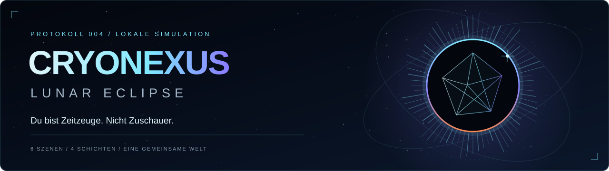
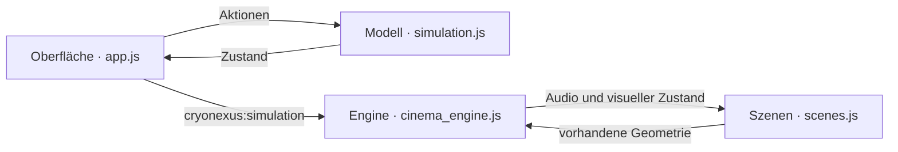

# CRYONEXUS · Lunar Eclipse

**Du bist Zeitzeuge. Nicht Zuschauer.**

Eine deutschsprachige, prozedurale 3D-Erfahrung zwischen Eis, Finsternis und Schattenmarkt. Sechs Szenen teilen sich ein deterministisches Simulationsmodell: Deine Käufe, Bindungen und Phasenwechsel verändern Zahlen, Vault-Zugang und die sichtbare Welt.

**[App öffnen](https://pierreg99.github.io/CryoNexis-Lunar-Eclispe/) · [Lokal starten](#in-einer-minute-starten) · [Handbuch / Wiki](docs/wiki/Home.md) · [Architektur](docs/wiki/Architektur.md) · [Prüfbericht](VERIFICATION.md)**

| Erlebnis | Architektur | Auslieferung | Prüfung |
| --- | --- | --- | --- |
| 6 prozedurale Szenen | 4 getrennte Schichten | 851.371 Bytes in `dist/` | 37 reine Testgruppen sowie Desktop-/Mobilspielwege und Browser-Akzeptanzprüfungen |

## In einer Minute starten

```sh
git clone --branch main https://github.com/Pierreg99/CryoNexis-Lunar-Eclispe.git
cd CryoNexis-Lunar-Eclispe
python3 -m http.server 8080 --directory dist
```

Öffne **http://localhost:8080**. Die auslieferbare App braucht keinen Build und keine Installation. Three.js, Shader, Schriftarten und Audio bleiben lokal; es gibt keine kostenpflichtige API oder Server-Datenbank. `dist/index.html` lässt sich in Browsern öffnen, die `file://` erlauben. Bei gesperrten Datei-URLs funktioniert der lokale Server.

## Was du verändern kannst

| Deine Handlung | Berechnete Folge | Sichtbare Reaktion |
| --- | --- | --- |
| Knoten kaufen oder verkaufen | Bestand, Vermögen, Gebühren und Slippage ändern sich | Das Kristallfeld reagiert auf deine Positionen |
| Knoten zeitlich binden | Stärke und Liquidität steigen; 1.200 CNX werden verbraucht | Die zugehörigen Nexus-Schollen rücken zusammen |
| Netzwerk stabilisieren | Bis zu +8 Stärke und +7 Kohärenz für 700 CNX | Die Kammer und der gemeinsame Puls reagieren |
| Phase wählen | Marktbedingungen ändern sich; manuelle Wechsel kosten Kohärenz | Mondstellung, Korona und Diamantring folgen der Phase |
| Vault öffnen und befüllen | Einlagen verdienen im offenen Zeitfenster simulierte Zinsen | Würfelgitter öffnen sich, der Kern gewinnt an Leistung |

Du startest mit **100.000 fiktiven CNX**. Drei Bindungen, Stabilität ≥75 und Kohärenz ≥35 öffnen den Vault während **Korona** oder **Freisteller**. Deine Zeitspuren und die Zufallsfolge werden lokal gespeichert. Alle Werte folgen dokumentierten Spielregeln; sie sind keine realen Markt- oder Astronomiedaten.

**[Ersten Vault öffnen →](docs/wiki/Schnellstart.md#dein-erster-vault) · [Alle Regeln und Zahlen →](docs/wiki/Simulation.md)**

Das Terminal liefert konkrete Ergebnisbelege mit Gebühren, Geldfluss und Beständen. `help buy` erklärt einen einzelnen Befehl; `tasks` zeigt sechs aktuelle Aufgaben mit nächsten Schritten. [Alle Befehle und Ergebnisse →](docs/wiki/Terminal.md)

## Die sechs Welten

| Kammer | Finsternis | Eis-Nexus |
| --- | --- | --- |
| Kristallgitter, Frost und schwebende Partikel | Prozeduraler Mond, Korona und Plasmabögen | 46 Schollen mit eigenen Umlaufbahnen |

| Schattenmarkt | Vault | Jenseits der Zeit |
| --- | --- | --- |
| 130 Kristalle, sechs Knoten und echte Spielentscheidungen | Terminal, Datensäulen und bedingter Zugang | Nebel, Staub und steuerbare Zeitlinie |

Bloom, ACES, Filmkorn, Scanlines, Vignette und chromatische Aberration verbinden die Szenen. Klang entsteht lokal und startet erst über den Klang-Button. „Bewegung reduzieren“ stoppt automatische Animationen und Simulationszeit; Handel, Terminal und manuelle Schritte bleiben nutzbar.

„Welt erkunden“ und „Zur Simulation“ bieten zwei direkte Einstiege. Die Navigation markiert die aktuelle Sektion. Im Schattenmarkt führt „Dein erster Vault“ anhand deines Fortschritts zur nächsten Aktion; Knotendetails, verständliche Quotes und dauerhafte Aktionsbelege helfen beim Handel. Mobile Eingaben bleiben gut lesbar.

## Vier Schichten, klare Zuständigkeiten



Die Oberfläche enthält keine 3D-Geometrie. Das Modell kennt weder DOM noch Speicher. Die Engine besitzt höchstens zwei WebGL-Kontexte und rendert ausschließlich sichtbare Szenen. GPU-Daten ausgeblendeter Szenen und große Puffer freier Slots werden freigegeben; CPU-Szenen bleiben gecacht. Viertelauflösender Bloom verwendet zwei permanente Targets ohne Allokationen pro Frame. Die Oberfläche startet mit 154.717 Bytes JavaScript; Three.js und Szenen (633.171 Bytes) laden nach dem ersten UI-Paint nach. Die frühere künstliche 2,4-Sekunden-Boot-Sequenz entfällt. Bei reduzierter Bewegung werden die Grafikskripte erst nach Aktivierung der Bewegung geladen. Alle Skripte laden klassisch und lokal, ohne Bundler oder ES-Modulimporte.

**[Modulverträge →](docs/wiki/Architektur.md) · [Szenen und Shader →](docs/wiki/Szenen.md) · [Farben und Gestaltung →](docs/wiki/Designsystem.md)**

## Prüfen und weiterentwickeln

```sh
npm ci
npx playwright install chromium
npm test
```

Nur das Modell prüfen: `npm run test:simulation`. Diese Werkzeuge sind Entwicklungsabhängigkeiten; `dist/` benötigt sie nicht.

Die Testsuite umfasst 37 reine Gruppen und sechs Browser-Spielwege für Journal, Geheimnisse und Bedienung vor den Akzeptanzprüfungen. Sie prüft echte Hinweise, einmalige Entdeckungen, sichere Speicherung, unveränderte Marktregeln und Desktop-/Mobilbedienung. Frühere Prüfungen decken zusätzlich die GPU-Ressourcen bei DPR 2 ab. Datei-URL-Versuche können durch die verwaltete Browserrichtlinie blockiert werden. **60 FPS und der gesamte VRAM auf echter Hardware sind noch nicht nachgewiesen.** Die konservative Target-Schätzung ist auf 24,7 MB für beide Renderer-Slots begrenzt. Ergebnisse, Testauswahl und Messgrenzen stehen im [Prüfbericht](VERIFICATION.md) und im [Test-Handbuch](docs/wiki/Tests-und-Qualitaet.md).

## Dokumentation und Hosting

Das [Handbuch](docs/wiki/Home.md) führt vom ersten Vault bis zu Formeln, Modulverträgen und Veröffentlichung. Seine Markdown-Seiten liegen versioniert in `docs/wiki/`; Sidebar und Footer sind für das GitHub-Wiki vorbereitet. Das Wiki ist auf GitHub aktiviert, sein separates Git-Repository ist noch nicht initialisiert. Das [Veröffentlichungsskript](scripts/publish-wiki.py) exportiert und synchronisiert die Seiten, sobald eine erste Wiki-Seite angelegt wurde.

Die vollständige App ist auf **[GitHub Pages](https://pierreg99.github.io/CryoNexis-Lunar-Eclispe/)** veröffentlicht. Der [Pages-Workflow](.github/workflows/pages.yml) liefert alle fünfzehn Laufzeitdateien unverändert aus `main/dist/` aus. Änderungen an der App auf `main` werden automatisch veröffentlicht; eine manuelle Veröffentlichung ist über „Run workflow“ möglich. GitHub Pages ist für öffentliche Repositories innerhalb der geltenden GitHub-Limits kostenlos; die App benötigt keine zusätzlichen Dienste. [Hosting und Wiki veröffentlichen →](docs/wiki/Hosting-und-Wiki.md)

Three.js r149 ist lokal enthalten und unter MIT lizenziert: [Lizenz](dist/assets/vendor/THREE-LICENSE.txt). Für den eigenen Projektcode ist bislang keine separate Lizenz festgelegt.

## Astro Zen Show

Der Button **ASTRO ZEN SHOW** startet eine ruhige Rundreise durch die sechs bestehenden Szenen. Alle 18 Sekunden wechselt die Ansicht. **Pause**, **Zurück**, **Weiter** und **Beenden** bleiben erreichbar; Escape beendet die Show und stellt Position und Fokus wieder her. Klang lässt sich separat einschalten. Die Show selbst verändert keine Simulationswerte; der vorherige Zeitmodus läuft weiter.

Bei reduzierter Bewegung bleiben die ruhigen Hintergrundansichten ohne 3D-Download erhalten und du wechselst manuell. Verborgene Tabs unterbrechen den Show-Timer. Das eigene Modul `astro-zen.js` verwendet die bestehenden Renderer und benötigt keine externen Dienste.

## Zeitlich begrenzter CRYO-Zugang

Mit **`unlock cryo`** öffnest du den Vault unabhängig von Phase, Bindungen, Stabilität und Kohärenz bis einschließlich **31. Oktober 2026, 23:59:59 UTC**. Alle Ansichten und vorhandenen Aktionen bleiben nutzbar; Einlagern, Entnehmen und simulierte Zinsen funktionieren im offenen Vault. Guthaben- und Mengenlimits gelten weiterhin. `vault` zeigt den Zugang und das Ablaufdatum; `help` erklärt alle 35 Befehle.

Die Freischaltung wird lokal gespeichert. Ab **1. November 2026, 00:00 UTC** gelten wieder die normalen Zugangsbedingungen; Guthaben bleibt erhalten. `reset confirm` entfernt auch die Freischaltung. Das Datum folgt der Geräteuhr der lokalen Simulation, nicht einer serverseitigen Zugangskontrolle.

## Forschungssphäre und Fähigkeiten

**`unlock cryo`** und **`cryo unlock`** laden das Observatorium. Zwei erfasste Phasen plus eine Knotenposition öffnen das Resonanzlabor. Fünf erfasste Phasen, drei kalibrierte Knoten und Vault-Ertrag öffnen das Zeitarchiv. Alle Aufgaben sind über die Forschungskarten in der letzten Sektion bedienbar; `missions`, `observe`, `calibrate ID` und `decode` bieten dieselben Aktionen im Terminal.

Forschungsnachweise bleiben lokal gespeichert. Beobachtungen verändern die Finsternis, Resonanzbaken das Nexus-Signal und die entschlüsselte Zeitspur den Nebel. Vier Forschungsdateien laden erst nach Zugang und jeweiliger Freischaltung; sie benötigen keine zusätzlichen Renderer oder Dienste. [Fähigkeiten, Aufgaben und Freischaltungen →](docs/wiki/Forschung.md)

## Entdeckerjournal, Quests und Geheimnisse

**JOURNAL** öffnet sechs dauerhaft spielbare Story-Aufträge. Prüfe die Signale in den sechs Szenen, stelle eine Bake wieder her und bewahre Zeit im Vault. Fortschritt und einmalige Belohnungen bleiben lokal gespeichert. Das Journal weist zur nächsten unbesuchten Szene und bietet eine eigene Zeitpause.

Sechs verborgene Übertragungen lassen sich aus den Szenensignalen erschließen. Drei neue eigene Geschichten führen dich auf einen Rückweg, zu einer siebten Stimme und zu einer Antwort auf eine empfangene Nachricht. Zwei ungewöhnliche Echos warten zusätzlich auf Hinweise aus dem Vault. Codes und Wörter kannst du direkt im Journal oder im Terminal senden. Dein Archiv sammelt Dossiers und Titel; Entdeckungen öffnen die Lichtsignaturen **Glut** und **Aurora**. Alle Inhalte bleiben auch nach Ablauf des CRYO-Zugangs spielbar.

Starte mit `quests`, `quest arrival` und `inspect kammer` oder nutze die sichtbaren Signal-Buttons. `claim ID` holt eine erreichte Belohnung ab; `secrets`, `signal Code`, `echo Wort` und `theme` erschließen weitere Spuren. `npm run test:journey` prüft den Questweg, `npm run test:secrets` die zusätzlichen Geheimnisse, ihre echten Hinweise, sichere Speicherung und Desktop-/Mobilbedienung. **[Journal-Handbuch und optionale Lösungen →](docs/wiki/Quests-und-Geheimnisse.md)**
