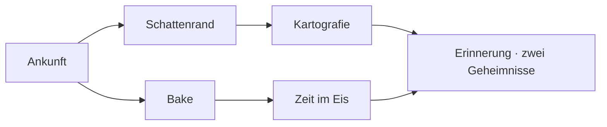

# Quests und Geheimnisse

**[Handbuch](Home.md) / Entdecken**

Das **Entdeckerjournal** verbindet sechs Aufträge, drei verborgene Übertragungen und zwei ungewöhnliche Echos. Es ist unabhängig vom zeitlich begrenzten CRYO-Zugang verfügbar. Öffne **JOURNAL** in der oberen Leiste oder tippe `quests` ins Terminal.

## Dein erster Auftrag

1. Nimm **Ankunft in Kammer 04** an.
2. Öffne die Kammer und wähle **KAMMERSIGNAL PRÜFEN**.
3. Kehre ins Journal zurück und hole die Belohnung ab.

Weitere Aufträge öffnen sich, sobald du die Belohnung ihrer Vorgänger abgeholt hast. Ein erfüllter Auftrag bleibt erfüllt, wenn du später die Phase wechselst, Bindungen löst oder Geld entnimmst. Jede Belohnung gibt es einmal.

| Auftrag | Nachweis | Belohnung |
| --- | --- | --- |
| Ankunft in Kammer 04 | Kammersignal prüfen | Erstes Dossier |
| Der Schatten hat einen Rand | Finsternis während Korona prüfen | Dossier über die Nachricht am Schattenrand |
| Kartograf des Unsichtbaren | Signale aller sechs Szenen prüfen | Titel „Zeitzeuge“ |
| Eine Bake im Eis | Gebundenen Knoten auf mindestens 90 % stabilisieren | Dossier über die letzte Bake |
| Zeit im Eis | Mit mindestens 1.000 CNX im offenen Vault in einem Schritt positiven Ertrag erzeugen | Dossier über gespeicherte Zeit |
| Die Kammer erinnert sich | Zwei Geheimnisse finden und Vorgänger abschließen | Titel „Hüter der Kammer“ und Aurora |

Die Kartografie weist auf die nächste noch nicht untersuchte Szene. Im Journal kannst du die Zeit pausieren und direkt zur Phasenwahl springen. So bleiben Signale in einer gewünschten Phase erreichbar. Manuelle Phasenwechsel und die normalen Knotenaktionen behalten ihre Kosten.

Neue gültige Beacon- und Vault-Nachweise zählen auch vor dem Öffnen des Journals. Ein alter Spielstand ohne Journal-Nachweise erfindet keine Vergangenheit: Eine neue Stabilisierung oder ein neuer Ertragsschritt liefert den fehlenden Beleg. Ertrag von einer kleinen Einlage und eine spätere große Einlage ersetzen keinen gemeinsamen Nachweis.

## Verborgene Übertragungen

In jeder Szene liegt ein prüfbares Signal. Es reagiert auf deine aktuelle Situation und enthält manchmal eine Spur zum nächsten Fund. Wiederholtes Prüfen kostet nichts. **Geheimnisse** zeigt zunächst unbekannte Signale; Hinweise lassen sich bewusst aufklappen.

Eine verschlossene Frequenz verlangt drei gelesene Übertragungen und einen daraus abgeleiteten Code. Zwei andere Erinnerungen reagieren auf Stille beziehungsweise zurückkehrendes Licht. Falsche Codes, unbekannte Wörter und wiederholte Belohnungen verändern den Spielstand nicht.

Die Randnotizen im Vault weisen auf alte Geschichten und interaktive Abenteuer hin. `echo Wort` kann eine ungewöhnliche Antwort hervorbringen. Gefundene Echos erscheinen im Journal und im Archiv.

## Archiv und Signaturen

**Archiv & Signaturen** sammelt verdiente Dossiers, Titel, Geheimnisse und Echos. **Frost** ist von Anfang an verfügbar. Die verlorene Frequenz öffnet **Glut**; der letzte Auftrag öffnet **Aurora**. Wähle dort eine Signatur oder nutze `theme ID`. Die Auswahl bleibt nach dem Neuladen erhalten.

Belohnungen sind Geschichten und Gestaltung. Sie erzeugen keine CNX, verändern keine Zufallsfolge und umgehen keine Vault-Bedingungen. Die regulären Spielaktionen behalten ihre Wirkung. **Neustart** und `reset confirm` löschen auch Journal, Entdeckungen und die gewählte Signatur.

## Terminal

| Befehl | Wirkung |
| --- | --- |
| `quests` | Aufträge, IDs, Fortschritt und nächste Schritte lesen |
| `quest arrival` | Einen verfügbaren Auftrag annehmen |
| `claim arrival` | Eine erreichte Belohnung abholen |
| `inspect kammer` | Signal prüfen; auch finsternis, nexus, knoten, vault und nebel |
| `inspect` | Signal der aktuellen Ansicht prüfen |
| `secrets` | Entdeckungen und Hinweise lesen |
| `signal Code` | Frequenz rekonstruieren |
| `echo Wort` | Nach ungewöhnlichen Antworten suchen |
| `theme` / `theme frost` | Signaturen lesen / auswählen |

Komplette Lösungen anzeigen — Spoiler

Die **Frequenz 004** entsteht aus Kammer 04, 46 Schollen und Brechungsindex 1,3091: `signal 004-46-13091`. Zuvor Kammer, Finsternis und Nexus prüfen.

Das **Archiv der Stille** öffnet sich mit `pause`, danach `inspect nebel`. **Zwischen Licht und Eis** erscheint nach einer Finsternisinspektion mit `phase Freisteller`, danach `inspect nexus`.

Die alten Antworten lauten `echo 42` und `echo xyzzy`. Ein erfolgreicher Fund wird einmal gespeichert; erneutes Senden erzeugt keine zweite Belohnung.

**Weiter:** [Bedienung](Bedienung.md) · [Terminal](Terminal.md) · [Forschung](Forschung.md)
